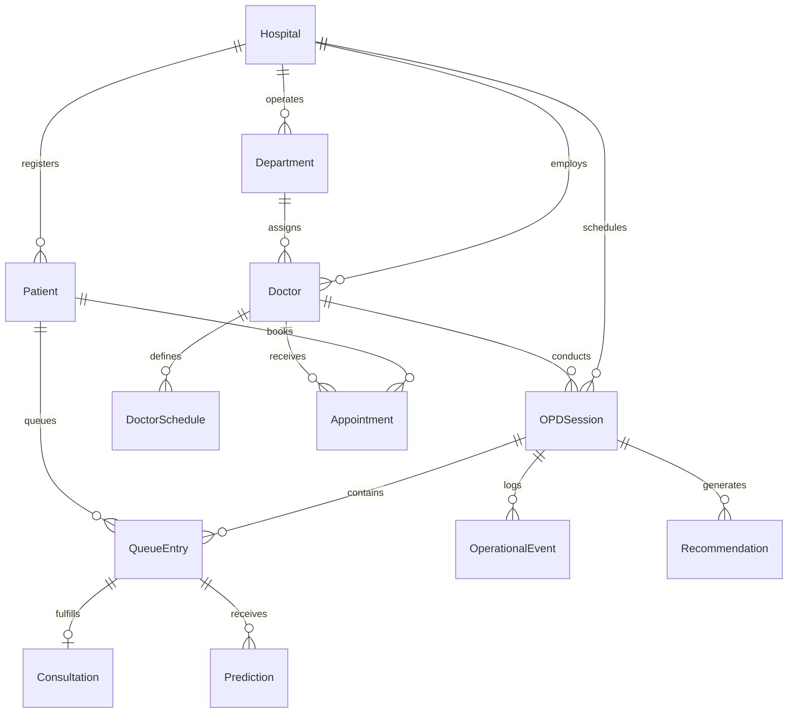

# QueueX — Cloud Firestore Database Architecture & Schema Specification

> GDG Vizag Local2Global Hackathon • Feature F0.3

---

## 1. Architectural Model & Philosophy

QueueX is designed around a **document-oriented, multi-tenant hierarchy** optimized for outpatient department (OPD) queue operations, high-velocity queue transitions, and historical operational intelligence.

### Design Principles

1. **Hospital-Scoped Tenancy**: Every operational entity lives under `/hospitals/{hospitalId}/{collection}/{docId}`. This isolates hospital data, streamlines security rules, and allows collection-group queries across hospitals when needed.
2. **Shallow Subcollection Depth**: We strictly avoid nesting subcollections deeper than one level below the hospital document (`/hospitals/{hId}/{collection}/{docId}`). Deep nesting (e.g. `hospitals/.../departments/.../doctors/.../sessions/.../queue/...`) leads to query inflexibility and complex path generation.
3. **Selective Denormalization**: High-frequency operational screens (e.g., waiting room displays, doctor call monitors) must load in a single document read without cascading joins across patients, doctors, and departments.
4. **State vs. History Segregation**: Current queue state (`QueueEntry`) is updated in real time and is transient per session, whereas clinical consultations (`Consultation`) and disruptions (`OperationalEvent`) are immutable historical records used for analytics and wait-time prediction.

---

## 2. Entity Relationship Overview

### Entity Classification

| Entity | Category | Scope | Frequency of Mutation | Analytical Role |
| :--- | :--- | :--- | :--- | :--- |
| **Hospital** | Independent | Root tenant | Very Low | Multi-tenant boundary |
| **Department** | Semi-independent | `hospitals/{id}/departments` | Low | Department throughput KPI |
| **Doctor** | Dependent | `hospitals/{id}/doctors` | Low | Doctor consultation pace & roster |
| **DoctorSchedule** | Dependent | `hospitals/{id}/schedules` | Low | Planned capacity vs actuals |
| **OPDSession** | Operational | `hospitals/{id}/sessions` | Medium (starts, pauses, finishes) | Session duration & utilization |
| **Patient** | Independent | `hospitals/{id}/patients` | Low (updates on revisit) | Patient history & demographics |
| **Appointment** | Dependent | `hospitals/{id}/appointments` | Low (booked, checked-in) | Slot booking vs walk-in distribution |
| **QueueEntry** | Operational State | `hospitals/{id}/queueEntries` | **High** (waiting → called → done) | Real-time queue monitor |
| **Consultation** | Immutable Record | `hospitals/{id}/consultations` | Append-only (on completion) | Wait-time prediction baseline |
| **OperationalEvent** | Event Stream | `hospitals/{id}/operationalEvents` | Append-only (on incidents) | Disruption & bottleneck analytics |
| **Prediction** | Forecast | `hospitals/{id}/predictions` | Periodic update | Dynamic wait-time estimates |
| **Recommendation** | Prescriptive | `hospitals/{id}/recommendations` | Real-time trigger | Bottleneck resolution actions |

---

## 3. Selective Denormalization Rationale

In relational SQL databases, foreign keys normalize data to eliminate redundancy. In Firestore, doing 50 joins to display an OPD waiting list is slow and costly. We selectively denormalize:

- **Inside `QueueEntry`**:
  - `patientName`, `patientAge`, `patientGender` (avoids querying `Patient` on every token call).
  - `doctorName`, `departmentName` (avoids querying `Doctor` and `Department` for display screens).
  - `tokenDisplay` (e.g. `CARD-014` formatted and ready for patient monitors).
- **Inside `Consultation`**:
  - `patientName`, `doctorName`, `departmentName` (preserves historical snapshot even if doctor or department changes).
- **Inside `OPDSession`**:
  - `doctorName`, `departmentName`, `roomNumber` (fast session listing without doctor joins).

---

## 4. Collections and Document Schemas

### 1. `hospitals`
**Path**: `/hospitals/{hospitalId}`

| Field | Type | Required | Description |
| :--- | :--- | :--- | :--- |
| `id` | string | Yes | Unique hospital ID |
| `name` | string | Yes | Full hospital name (e.g. "Vizag General Hospital") |
| `code` | string | Yes | Short uppercase code (e.g. "VZG-GH") |
| `address` | string | Yes | Street address |
| `city` | string | Yes | City (e.g. "Visakhapatnam") |
| `state` | string | Yes | State |
| `postalCode` | string | Yes | Postal PIN code |
| `timezone` | string | Yes | Timezone (default: "Asia/Kolkata") |
| `phone` | string | Yes | Central contact phone |
| `email` | string | Yes | Central contact email |
| `isActive` | boolean | Yes | Whether hospital is operational |
| `createdAt` | Timestamp | Yes | Creation timestamp |
| `updatedAt` | Timestamp | Yes | Last update timestamp |

---

### 2. `departments`
**Path**: `/hospitals/{hospitalId}/departments/{departmentId}`

| Field | Type | Required | Description |
| :--- | :--- | :--- | :--- |
| `id` | string | Yes | Unique department ID |
| `hospitalId` | string | Yes | Parent hospital ID |
| `name` | string | Yes | Department title (e.g. "Cardiology") |
| `code` | string | Yes | 2-4 letter uppercase code (e.g. "CARD") |
| `description` | string | No | Scope of care description |
| `floor` | string | No | Hospital floor / building wing |
| `avgConsultationDurationMinutes` | number | Yes | Default estimated pace (e.g. 15) |
| `isActive` | boolean | Yes | Department operational status |
| `createdAt` | Timestamp | Yes | Creation timestamp |
| `updatedAt` | Timestamp | Yes | Last update timestamp |

---

### 3. `doctors`
**Path**: `/hospitals/{hospitalId}/doctors/{doctorId}`

| Field | Type | Required | Description |
| :--- | :--- | :--- | :--- |
| `id` | string | Yes | Unique doctor ID |
| `hospitalId` | string | Yes | Parent hospital ID |
| `departmentId` | string | Yes | Assigned department ID |
| `departmentName` | string | Yes | Denormalized department name |
| `name` | string | Yes | Doctor full name (e.g. "Dr. Aruna Rao") |
| `qualification` | string | Yes | Medical degrees (e.g. "MBBS, MD (Cardio)") |
| `specialization` | string | Yes | Sub-specialization |
| `roomNumber` | string | Yes | Assigned OPD consultation room |
| `consultationDurationEstimate` | number | Yes | Expected minutes per consultation |
| `isActive` | boolean | Yes | Active duty status |
| `createdAt` | Timestamp | Yes | Creation timestamp |
| `updatedAt` | Timestamp | Yes | Last update timestamp |

---

### 4. `schedules`
**Path**: `/hospitals/{hospitalId}/schedules/{scheduleId}`

| Field | Type | Required | Description |
| :--- | :--- | :--- | :--- |
| `id` | string | Yes | Unique schedule ID |
| `hospitalId` | string | Yes | Parent hospital ID |
| `doctorId` | string | Yes | Doctor ID |
| `departmentId` | string | Yes | Department ID |
| `workingDays` | number[] | Yes | Array of day indices (0=Sun, 1=Mon, ..., 6=Sat) |
| `startTime` | string | Yes | HH:MM format (e.g. "09:00") |
| `endTime` | string | Yes | HH:MM format (e.g. "13:00") |
| `maxPatientsPerSession` | number | Yes | Maximum patient ceiling |
| `breakPeriods` | array | Yes | Array of `{ startTime, endTime, label }` |
| `isActive` | boolean | Yes | Active schedule flag |
| `createdAt` | Timestamp | Yes | Creation timestamp |
| `updatedAt` | Timestamp | Yes | Last update timestamp |

---

### 5. `sessions`
**Path**: `/hospitals/{hospitalId}/sessions/{sessionId}`

| Field | Type | Required | Description |
| :--- | :--- | :--- | :--- |
| `id` | string | Yes | Unique OPD session ID |
| `hospitalId` | string | Yes | Parent hospital ID |
| `departmentId` | string | Yes | Department ID |
| `departmentName` | string | Yes | Denormalized department title |
| `doctorId` | string | Yes | Doctor ID |
| `doctorName` | string | Yes | Denormalized doctor name |
| `roomNumber` | string | Yes | Room number |
| `date` | string | Yes | YYYY-MM-DD date string |
| `startTime` | string | Yes | Scheduled start time (HH:MM) |
| `endTime` | string | Yes | Scheduled end time (HH:MM) |
| `status` | string | Yes | `scheduled` \| `active` \| `paused` \| `completed` \| `cancelled` |
| `currentRunningToken` | number | No | Currently called token number |
| `totalTokensIssued` | number | Yes | Total tokens issued today |
| `completedCount` | number | Yes | Total completed consultations |
| `waitingCount` | number | Yes | Current waiting patient count |
| `startedAt` | Timestamp | No | Actual session start timestamp |
| `completedAt` | Timestamp | No | Actual session completion timestamp |
| `createdAt` | Timestamp | Yes | Creation timestamp |
| `updatedAt` | Timestamp | Yes | Last update timestamp |

---

### 6. `patients`
**Path**: `/hospitals/{hospitalId}/patients/{patientId}`

| Field | Type | Required | Description |
| :--- | :--- | :--- | :--- |
| `id` | string | Yes | Unique patient ID |
| `hospitalId` | string | Yes | Parent hospital ID |
| `uhid` | string | Yes | Unique Health ID / Hospital MRN (e.g. "QX-1002") |
| `name` | string | Yes | Full patient name |
| `age` | number | Yes | Patient age in years |
| `gender` | string | Yes | `male` \| `female` \| `other` |
| `phone` | string | Yes | Contact phone number |
| `email` | string | No | Contact email |
| `bloodGroup` | string | No | Blood group (e.g. "B+") |
| `emergencyContact` | object | No | `{ name, phone, relation }` |
| `createdAt` | Timestamp | Yes | Creation timestamp |
| `updatedAt` | Timestamp | Yes | Last update timestamp |

---

### 7. `appointments`
**Path**: `/hospitals/{hospitalId}/appointments/{appointmentId}`

| Field | Type | Required | Description |
| :--- | :--- | :--- | :--- |
| `id` | string | Yes | Unique appointment ID |
| `hospitalId` | string | Yes | Parent hospital ID |
| `patientId` | string | Yes | Patient ID |
| `patientName` | string | Yes | Denormalized patient name |
| `patientPhone` | string | Yes | Patient phone |
| `doctorId` | string | Yes | Doctor ID |
| `doctorName` | string | Yes | Denormalized doctor name |
| `departmentId` | string | Yes | Department ID |
| `departmentName` | string | Yes | Denormalized department name |
| `scheduledDate` | string | Yes | YYYY-MM-DD |
| `scheduledTime` | string | Yes | HH:MM |
| `scheduledAt` | Timestamp | Yes | Combined scheduled timestamp |
| `appointmentType` | string | Yes | `regular` \| `follow_up` \| `referral` |
| `status` | string | Yes | `booked` \| `checked_in` \| `completed` \| `cancelled` \| `no_show` |
| `tokenNumber` | number | No | Assigned token number upon check-in |
| `queueEntryId` | string | No | Linked queue entry ID |
| `createdAt` | Timestamp | Yes | Creation timestamp |
| `updatedAt` | Timestamp | Yes | Last update timestamp |

---

### 8. `queueEntries`
**Path**: `/hospitals/{hospitalId}/queueEntries/{queueEntryId}`

| Field | Type | Required | Description |
| :--- | :--- | :--- | :--- |
| `id` | string | Yes | Unique queue entry ID |
| `hospitalId` | string | Yes | Parent hospital ID |
| `departmentId` | string | Yes | Department ID |
| `departmentName` | string | Yes | Denormalized department name |
| `doctorId` | string | Yes | Doctor ID |
| `doctorName` | string | Yes | Denormalized doctor name |
| `sessionId` | string | Yes | Active OPD session ID |
| `patientId` | string | Yes | Patient ID |
| `patientName` | string | Yes | Denormalized patient name |
| `patientAge` | number | Yes | Patient age |
| `patientGender` | string | Yes | `male` \| `female` \| `other` |
| `tokenNumber` | number | Yes | Sequential token number |
| `tokenDisplay` | string | Yes | Formatted token string (e.g. "CARD-014") |
| `source` | string | Yes | `appointment` \| `walk_in` \| `emergency` |
| `priority` | string | Yes | `normal` \| `priority` \| `emergency` |
| `status` | string | Yes | `waiting` \| `called` \| `in_consultation` \| `completed` \| `skipped` \| `cancelled` |
| `arrivalTime` | Timestamp | Yes | When patient registered / arrived |
| `calledAt` | Timestamp | No | When doctor called the token |
| `consultationStartedAt` | Timestamp | No | When doctor began consultation |
| `consultationCompletedAt` | Timestamp | No | When consultation ended |
| `estimatedWaitMinutes` | number | No | Dynamically predicted wait time |
| `notes` | string | No | Triage or clinical notes |
| `createdAt` | Timestamp | Yes | Creation timestamp |
| `updatedAt` | Timestamp | Yes | Last update timestamp |

---

### 9. `consultations`
**Path**: `/hospitals/{hospitalId}/consultations/{consultationId}`

| Field | Type | Required | Description |
| :--- | :--- | :--- | :--- |
| `id` | string | Yes | Unique consultation ID |
| `hospitalId` | string | Yes | Parent hospital ID |
| `departmentId` | string | Yes | Department ID |
| `doctorId` | string | Yes | Doctor ID |
| `sessionId` | string | Yes | Session ID |
| `queueEntryId` | string | Yes | Linked queue entry ID |
| `patientId` | string | Yes | Patient ID |
| `tokenNumber` | number | Yes | Patient token number |
| `startedAt` | Timestamp | Yes | Actual start timestamp |
| `completedAt` | Timestamp | Yes | Actual completion timestamp |
| `durationSeconds` | number | Yes | Exact consultation length in seconds |
| `outcome` | string | Yes | `prescribed` \| `referred` \| `admitted` \| `tests_ordered` \| `routine_clear` |
| `delayReason` | string | No | Reason for delay if consultation took unusually long |
| `createdAt` | Timestamp | Yes | Record creation timestamp |

---

### 10. `operationalEvents`
**Path**: `/hospitals/{hospitalId}/operationalEvents/{eventId}`

| Field | Type | Required | Description |
| :--- | :--- | :--- | :--- |
| `id` | string | Yes | Unique event ID |
| `hospitalId` | string | Yes | Parent hospital ID |
| `departmentId` | string | No | Department ID |
| `doctorId` | string | No | Doctor ID |
| `sessionId` | string | No | Session ID |
| `queueEntryId` | string | No | Associated token ID |
| `eventType` | string | Yes | `doctor_paused` \| `doctor_resumed` \| `emergency_patient_added` \| ... |
| `severity` | string | Yes | `info` \| `warning` \| `critical` |
| `timestamp` | Timestamp | Yes | Incident timestamp |
| `actorRole` | string | Yes | `doctor` \| `nurse` \| `admin` \| `system` |
| `metadata` | map | Yes | Extensible payload attributes |

---

### 11. `predictions`
**Path**: `/hospitals/{hospitalId}/predictions/{predictionId}`

| Field | Type | Required | Description |
| :--- | :--- | :--- | :--- |
| `id` | string | Yes | Prediction ID |
| `hospitalId` | string | Yes | Parent hospital ID |
| `departmentId` | string | Yes | Department ID |
| `sessionId` | string | No | Session ID |
| `queueEntryId` | string | No | Queue entry ID |
| `predictionType` | string | Yes | `estimated_wait_time` \| `bottleneck_risk` \| ... |
| `targetValue` | number | Yes | Predicted value (minutes, probability score) |
| `confidenceScore` | number | Yes | Confidence score (0.0 to 1.0) |
| `contributingFactors` | array | Yes | Array of `{ factor, impactMinutes }` |
| `generatedAt` | Timestamp | Yes | Model calculation timestamp |
| `validUntil` | Timestamp | Yes | Expiration timestamp |

---

### 12. `recommendations`
**Path**: `/hospitals/{hospitalId}/recommendations/{recommendationId}`

| Field | Type | Required | Description |
| :--- | :--- | :--- | :--- |
| `id` | string | Yes | Recommendation ID |
| `hospitalId` | string | Yes | Parent hospital ID |
| `departmentId` | string | Yes | Department ID |
| `sessionId` | string | No | Session ID |
| `type` | string | Yes | `rebalance_queue` \| `call_next_doctor` \| `pause_walkins` \| ... |
| `title` | string | Yes | Short action title |
| `description` | string | Yes | Operational guidance |
| `priority` | string | Yes | `low` \| `medium` \| `high` \| `urgent` |
| `status` | string | Yes | `pending` \| `applied` \| `dismissed` |
| `actionPayload` | map | Yes | Target parameters for automated dispatch |
| `createdAt` | Timestamp | Yes | Generation timestamp |
| `appliedAt` | Timestamp | No | Application timestamp |

---

## 5. Composite Query Indexes (`firestore.indexes.json`)

1. **Queue Prioritization Query**:
   `queueEntries` scoped query: `where("sessionId", "==", sId).where("status", "==", "waiting").orderBy("priority", "desc").orderBy("arrivalTime", "asc")`
   - *Index*: `sessionId` ASC, `status` ASC, `priority` DESC, `arrivalTime` ASC.
2. **Doctor Active Queue Query**:
   `queueEntries` query: `where("doctorId", "==", dId).where("status", "==", "waiting").orderBy("tokenNumber", "asc")`
   - *Index*: `doctorId` ASC, `status` ASC, `tokenNumber` ASC.
3. **Daily Department Sessions Query**:
   `sessions` query: `where("departmentId", "==", deptId).where("date", "==", today).orderBy("startTime", "asc")`
   - *Index*: `departmentId` ASC, `date` ASC, `startTime` ASC.
4. **Doctor Historical Performance Query**:
   `consultations` query: `where("doctorId", "==", docId).orderBy("startedAt", "desc")`
   - *Index*: `doctorId` ASC, `startedAt` DESC.
5. **Session Disruption Audit Query**:
   `operationalEvents` query: `where("sessionId", "==", sId).orderBy("timestamp", "desc")`
   - *Index*: `sessionId` ASC, `timestamp` DESC.
